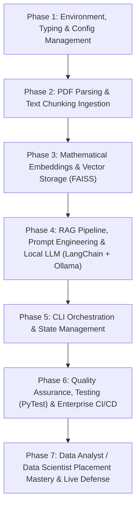

# 🎓 Complete Ground-Up Teaching & Interview Preparation Plan
## RAG PDF Chatbot (Enterprise LLM & Vector Retrieval System)
**Role Target:** Data Analyst / Data Scientist (Campus Placement & Entry-Level Industry Roles)  
**Pedagogical Model:** Zero-Assumed Knowledge • Syntax-First • Behavior • Architectural Rationale • Failure Analysis • Progressive Disclosure

---

## 🧭 Plan Structure Overview

This plan is engineered to rebuild and explain the entire repository from an empty directory up to an enterprise-grade AI system. Every phase is broken into bite-sized sub-steps. You will never face more than one syntax construct or library concept at a time.

---

## 📋 Phase 1: Environment, Type Annotations & Centralized Configuration
> **Recap:** Starting from ground zero. No prior code required.  
> **Core Files:** `requirements.txt`, `pyproject.toml`, `.env.example`, `src/config.py`

- **Step 1a: Dependency Declarations & Virtual Environments**
  - Syntax: `requirements.txt` pinning (`>=`, `==`), `python -m venv venv`, environment isolation.
  - Transferable Concept: Dependency drift, environment isolation, reproducible research.
- **Step 1b: Modern Packaging & Build Configuration (`pyproject.toml`)**
  - Syntax: TOML tables `[build-system]`, `[project]`, `dependencies`, and `optional-dependencies`.
  - Transferable Concept: PEP 517/621 packaging vs old `setup.py`.
- **Step 1c: Environment Variables & 12-Factor App Philosophy (`.env`, `python-dotenv`)**
  - Syntax: `os.getenv()`, `load_dotenv()`, casting types (`int()`, `float()`, `bool()`).
  - Transferable Concept: 12-Factor App methodology, keeping secrets out of version control.
- **Step 1d: Clean Object-Oriented Config with Python Dataclasses (`@dataclass`)**
  - Syntax: `@dataclass`, typed class fields (`model_name: str`, `Optional[int] = None`).
  - Transferable Concept: Immutability, strict typing, eliminating "stringly-typed" dictionaries.
- **Step 1e: Global Singleton Config Pattern**
  - Syntax: Factory function `load_config() -> AppConfig`, module-level instantiation `config = load_config()`.
  - Transferable Concept: Singleton pattern, single source of truth for runtime hyperparameters.

---

## 📋 Phase 2: PDF Parsing & Text Chunking Ingestion
> **Recap:** Building upon the typed `config.document_processing` settings established in Phase 1.  
> **Core Files:** `src/document_processor.py`

- **Step 2a: Recursive File Discovery & Path Manipulation**
  - Syntax: `os.walk()`, list comprehension, string filters (`.endswith(".pdf")`), `os.path.join()`.
  - Transferable Concept: File system traversal, cross-platform OS path normalization.
- **Step 2b: Binary PDF Ingestion with PyMuPDF (`PyMuPDFLoader`)**
  - Syntax: `from langchain_community.document_loaders import PyMuPDFLoader`, `loader.load()`.
  - Transferable Concept: Binary file parsing, C++ extraction engines vs pure Python parsers, Document data models (page content + metadata dictionary).
- **Step 2c: Defensive Programming & Error Recovery**
  - Syntax: `try-except` blocks, `warnings.warn()`, `raise FileNotFoundError`, `raise RuntimeError`.
  - Transferable Concept: Robust batch ETL pipelines; never letting one corrupt document crash a data job.
- **Step 2d: The LLM Context Window Problem & Text Chunking**
  - Syntax: `RecursiveCharacterTextSplitter(chunk_size, chunk_overlap)`.
  - Transferable Concept: Token budgets, loss of semantic context, sliding-window chunk overlap.
- **Step 2e: Hierarchical Splitting Strategy**
  - Syntax: Split separator priority (`["\n\n", "\n", " ", ""]`), `split_documents()`.
  - Transferable Concept: Natural language structural boundaries (paragraphs -> sentences -> words).

---

## 📋 Phase 3: Mathematical Embeddings & Vector Storage (FAISS)
> **Recap:** Building upon the raw document chunks generated in Phase 2 and embedding configurations from Phase 1.  
> **Core Files:** `src/vector_store.py`

- **Step 3a: Word Embeddings & Vector Space Theory**
  - Syntax: `from langchain_ollama import OllamaEmbeddings`, `embedding_model.embed_query("test")`.
  - Transferable Concept: High-dimensional semantic vectors (768d), mapping words to mathematical geometry.
- **Step 3b: Automatic Vector Dimension Discovery**
  - Syntax: Probing dynamic dimension length: `embedding_dim = len(test_embedding)`.
  - Transferable Concept: Eliminating hardcoded magic numbers in data pipelines; model-agnostic code.
- **Step 3c: FAISS Distance Metrics — Euclidean (L2) vs Cosine / Inner Product (IP)**
  - Syntax: `faiss.IndexFlatL2(embedding_dim)` vs `faiss.IndexFlatIP(embedding_dim)`.
  - Transferable Concept: Vector similarity mathematics, L2 distance vs Dot Product vs Cosine normalization.
- **Step 3d: In-Memory Document Store Mapping (`InMemoryDocstore`)**
  - Syntax: `from langchain_community.docstore.in_memory import InMemoryDocstore`, `FAISS(...)`.
  - Transferable Concept: Inverted index; connecting vector IDs back to raw document metadata and text.
- **Step 3e: Persistence & Local Serialization (`save_local`, `load_local`)**
  - Syntax: `vector_store.save_local()`, `FAISS.load_local(..., allow_dangerous_deserialization=True)`.
  - Transferable Concept: Vector database serialization (`index.faiss` + `index.pkl`), avoiding expensive re-embedding.
- **Step 3f: Retrieval Algorithms — Similarity vs Maximal Marginal Relevance (MMR)**
  - Syntax: `as_retriever(search_type="mmr", search_kwargs={"k": 3, "fetch_k": 100, "lambda_mult": 1.0})`.
  - Transferable Concept: Information retrieval trade-off: Relevance vs Diversity (preventing redundant answers).

---

## 📋 Phase 4: RAG Pipeline, Prompt Engineering & Local LLM (LangChain + Ollama)
> **Recap:** Connecting the FAISS retriever from Phase 3 with local inference using LangChain runnables.  
> **Core Files:** `src/rag_chain.py`

- **Step 4a: Local LLM Engine Initialization (`ChatOllama`)**
  - Syntax: `from langchain_ollama import ChatOllama`, `ChatOllama(model, base_url, temperature)`.
  - Transferable Concept: Local offline inference vs hosted APIs, temperature hyperparameter tuning (stochastic vs deterministic).
- **Step 4b: Context Injection & Prompt Template Engineering (`ChatPromptTemplate`)**
  - Syntax: `ChatPromptTemplate.from_template(template)` with `{question}` and `{context}` slots.
  - Transferable Concept: Grounding, hallucination mitigation, prompt constraining ("answer from context only").
- **Step 4c: Context Formatting Utility**
  - Syntax: Helper function `format_docs(docs) -> str`, `"\n\n".join([doc.page_content for doc in docs])`.
  - Transferable Concept: Context flattening, formatting raw document objects for LLM readability.
- **Step 4d: LangChain Expression Language (LCEL) Pipe Syntax (`|`)**
  - Syntax: `RunnablePassthrough()`, Unix-style pipeline chaining: `{"context": ..., "question": ...} | prompt | llm | StrOutputParser()`.
  - Transferable Concept: Functional streaming, DAG pipelines, composability in modern AI engineering.
- **Step 4e: Pipeline Invocation & Output Parsing (`StrOutputParser`)**
  - Syntax: `chain.invoke(question)`, transforming raw AIMessage objects to clean strings.
  - Transferable Concept: Structured parsing, end-to-end execution of a generative inference pipeline.

---

## 📋 Phase 5: Application Orchestration & CLI Interface
> **Recap:** Assembling DocumentProcessor (Phase 2), VectorStoreManager (Phase 3), and RAGChain (Phase 4) into a production application.  
> **Core Files:** `src/main.py`

- **Step 5a: Facade Architecture Pattern (`RAGPDFChatbot`)**
  - Syntax: `class RAGPDFChatbot`, instance attributes, initializing modular subcomponents in `__init__`.
  - Transferable Concept: Software design patterns: Facade pattern to hide complexity from consumer code.
- **Step 5b: Caching Logic & Index Rebuild Lifecycle**
  - Syntax: `if not rebuild_vector_store and self.vector_store_manager.vector_store_exists(): ... else: ...`.
  - Transferable Concept: Idempotency, incremental loading, computational cost optimization.
- **Step 5c: CLI Argument Parsing with `argparse`**
  - Syntax: `argparse.ArgumentParser()`, `add_argument("--rebuild", action="store_true")`, `parse_args()`.
  - Transferable Concept: Production CLI design, standard flags, automated `--help` generation.
- **Step 5d: Interactive REPL Loop & Graceful Signal Handling**
  - Syntax: `while True:`, `input()`, `KeyboardInterrupt`, handling exit commands (`q`, `exit`, `quit`).
  - Transferable Concept: User session management, non-blocking loops, clean termination.

---

## 📋 Phase 6: Automated Testing & Enterprise CI/CD
> **Recap:** Verifying the full codebase programmatically and enforcing enterprise quality gates.  
> **Core Files:** `tests/test_config.py`, `tests/test_document_processor.py`, `tests/test_integration.py`, `.github/workflows/ci.yml`

- **Step 6a: Test Fixtures & Unit Test Architecture (`pytest`)**
  - Syntax: `@pytest.fixture`, `assert`, testing expected exceptions with `pytest.raises()`.
  - Transferable Concept: Test-driven development, deterministic validation of data functions.
- **Step 6b: Mocking External Systems (`unittest.mock.patch`, `MagicMock`)**
  - Syntax: `@patch("os.walk")`, `@patch("src.document_processor.PyMuPDFLoader")`, setting `mock_instance.load.return_value`.
  - Transferable Concept: Isolated testing; verifying AI logic without needing physical GPUs, PDFs, or Ollama daemons.
- **Step 6c: Test Coverage Metrics (`pytest-cov`)**
  - Syntax: `--cov=src`, `--cov-fail-under=80`, branch coverage analysis.
  - Transferable Concept: Code health KPIs, detecting untested dead code branches.
- **Step 6d: Static Analysis & Code Quality Gates (`black`, `ruff`, `isort`)**
  - Syntax: AST parsing, PEP 8 enforcement, import sorting, lint rule configurations in `pyproject.toml`.
  - Transferable Concept: Automated code reviews, maintaining consistency in enterprise teams.
- **Step 6e: GitHub Actions CI/CD Pipeline Automation (`.github/workflows/ci.yml`)**
  - Syntax: GitHub workflow YAML syntax (`on: [push, pull_request]`, matrix builds for Python 3.9–3.12, runner steps).
  - Transferable Concept: Continuous Integration, automated testing on remote headless machines, automated PyPI release packaging.

---

## 📋 Phase 7: Data Analyst / Data Scientist Placement Mastery & Live Defense
> **Recap:** Transitioning from developer to interviewee; translating project engineering into top-tier placement answers.  
> **Deliverable Files:** Updated `docs/INTERVIEW_QA.md`, Elevator Pitch, Walkthrough Script.

- **Step 7a: Data Analyst Angle — Ingestion, Search Accuracy & Evaluation Metrics**
  - Concepts: Precision@K, Recall@K, MMR lambda tuning, query distribution, detecting hallucination.
- **Step 7b: Data Scientist Angle — Embeddings Geometry, Vector Quantization & LLM Architectures**
  - Concepts: Dense vs sparse embeddings, Cosine vs Euclidean distances, context window limits, chunking trade-offs.
- **Step 7c: System Limitations, Trade-offs & Production Roadmap**
  - Honest defense: In-memory FAISS vs distributed Qdrant/Pinecone, fixed chunking vs semantic chunking, adding rerankers (Cohere/BGE).
- **Step 7d: 60-90 Second Placement Pitch & 3-Minute Technical Walkthrough**
  - Memorizable, high-impact verbal script structured around Problem -> Architecture -> Engineering Decisions -> Business Impact.
- **Step 7e: Mock Interview Defense against the Top 10 Toughest Placement Questions**
  - Live technical stress-testing.

---

## 🚦 Phase Execution Protocol (Per Sub-Step)

For every sub-step in this plan:
1. **Actual Code:** The exact code block is quoted directly from your file with exact file paths and line numbers.
2. **Tri-Level Breakdown:**
   - **Syntax:** Every single keyword, operator, and method parameter explained in plain English.
   - **Behavior:** Step-by-step trace of what happens in RAM/CPU when this code runs.
   - **Architectural Rationale:** Why this was chosen over alternatives.
3. **Failure Analysis:** What specific error, bug, or vulnerability occurs if this block is omitted or altered.
4. **Transferable Skill:** The universal pattern applicable to real-world Data Science / Software Engineering jobs.
5. **Check-Back Question:** A conceptual check to verify your understanding.
6. **Concept Logging:** Updates logged to `CONCEPTS_LOG.md`.
7. **Interview Q&A:** Corresponding interview question added to `docs/INTERVIEW_QA.md`.

